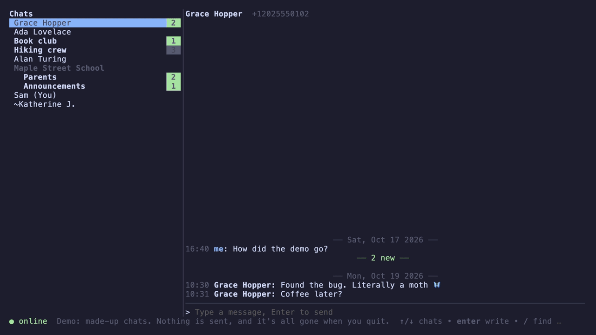
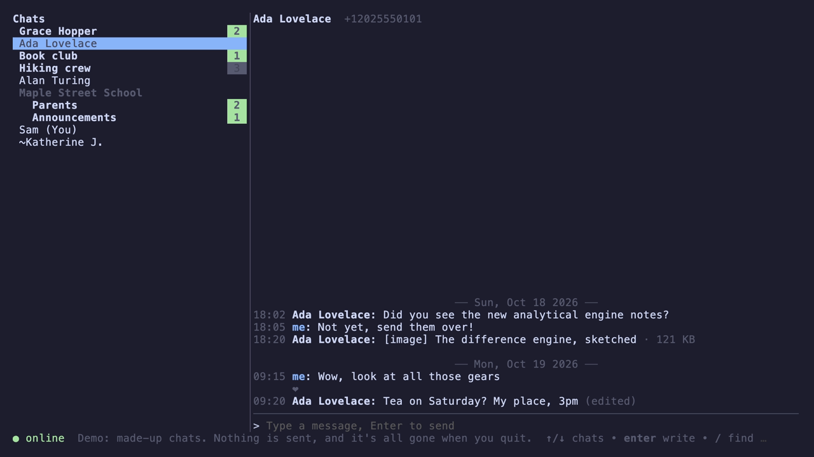
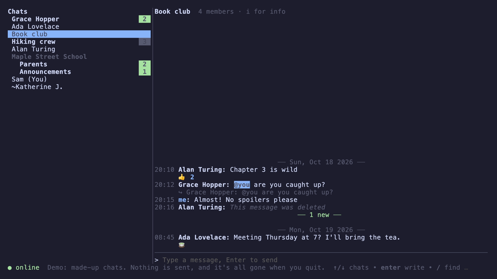
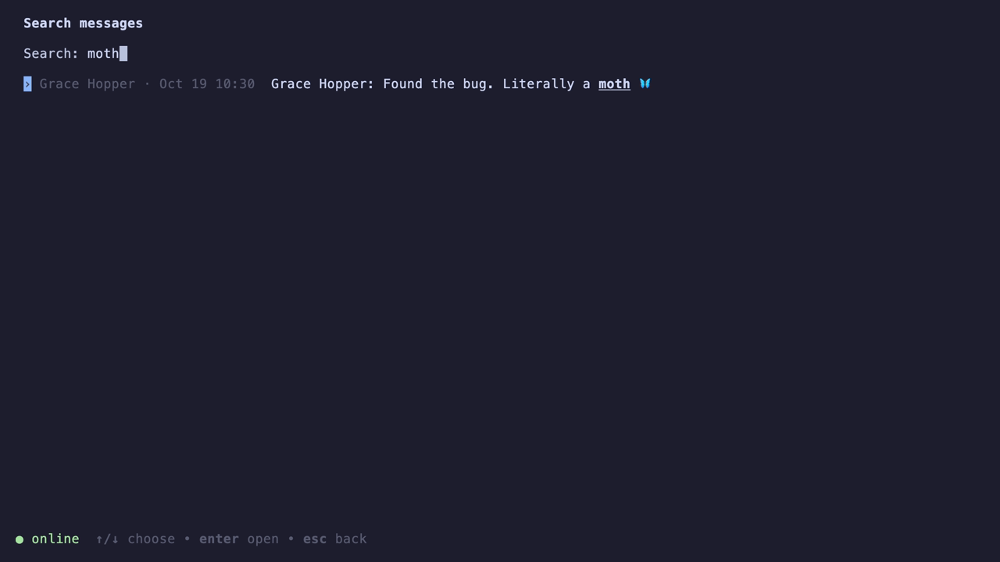
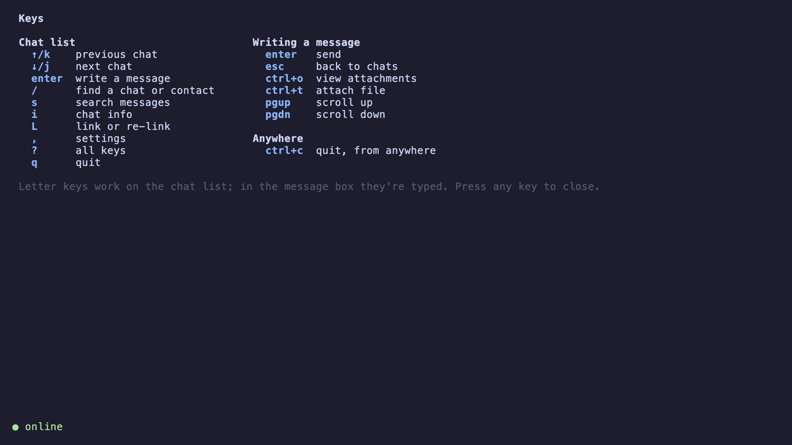

<p align="center">
    
</p>

[](https://github.com/wasichu/go-whassup/releases)
[](https://github.com/wasichu/go-whassup/actions/workflows/check.yml)
[](https://pkg.go.dev/github.com/wasichu/go-whassup)
[](LICENSE)

go-whassup is WhatsApp in your terminal: a single static binary, with no cgo and
nothing else to install or run, that links to your phone the way WhatsApp Web does.

It keeps your chats locally, so it starts instantly and works offline, and stays out
of your way: nothing is sent on your behalf unless you ask for it.

```console
$ go-whassup demo          # try it on made-up chats: no account, nothing kept
$ go-whassup               # link your phone (code or QR), then chat
$ go-whassup db search lunch plans
```

<p align="center">
    
</p>

> [!WARNING]
> **Unofficial.** go-whassup isn't made or endorsed by WhatsApp or Meta, and using
> third-party clients is against WhatsApp's Terms of Service. Accounts can be banned for
> it. go-whassup avoids bot-like behaviour (no automatic read receipts, no bulk fetching,
> no presence spam), but use it at your own risk, and not with an account you can't
> afford to lose.

💬 Chats and groups, unread counts, edits, deletes, reactions and @-mentions (shown;
sending reactions isn't supported yet). History is synced from your phone and searchable
offline.

📎 Attachments: open, preview, or save a copy. Send files from a browser with image
previews, or type a path with tab completion.

🖼️ Images inside the terminal (QR codes and previews) in Ghostty and kitty, tmux
included.

🔔 Desktop notifications through your terminal, quiet for muted chats.

🔒 Optional encryption of stored messages (keychain, a password command, or a
passphrase), turned on or off without restarting.

🧪 `go-whassup demo` runs the real interface on fictional chats, for trying it out and
for screenshots without anyone's data.

🧱 Built on [whatsmeow](https://github.com/tulir/whatsmeow) and Charm's
[Bubble Tea](https://github.com/charmbracelet/bubbletea), with pure-Go SQLite.

## Screenshots

All from `go-whassup demo`: fictional people, made-up chats.

<table>
    <tr>
        <td></td>
        <td></td>
    </tr>
    <tr>
        <td></td>
        <td></td>
    </tr>
</table>

## Installation

<table>
    <tr>
        <td>Homebrew (macOS or Linux)</td>
        <td>
            <code>brew install wasichu/tap/go-whassup</code>
        </td>
    </tr>
    <tr>
        <td>Go 1.26 or newer</td>
        <td>
            <code>go install github.com/wasichu/go-whassup/cmd/go-whassup@latest</code>
        </td>
    </tr>
    <tr>
        <td>Pre-built binaries</td>
        <td>
            macOS, Linux and Windows (amd64, arm64) on the
            <a href="https://github.com/wasichu/go-whassup/releases">releases page</a>,
            with <code>SHA256SUMS</code>
        </td>
    </tr>
</table>

Windows builds are untested, and the keychain key source isn't available there.

## Usage

```
Usage:
  go-whassup [-debug]                     start the TUI
  go-whassup login [-relink] [phone]      link this device with a phone-number code;
                                          -relink first unlinks the current session
  go-whassup listen [-debug]              connect and print incoming messages
  go-whassup db chats                     list stored chats (reads messages.db; no network)
  go-whassup db messages [-n N] <chat>    show a stored chat's newest N messages;
                                          <chat> is a name, phone number or JID
  go-whassup db search [-n N] <words>     search stored messages (newest N matches)
  go-whassup db reset                     delete stored messages and media (asks first)
  go-whassup demo                         try it on made-up chats (no account; nothing is kept)
```

The first run asks how to link: with a code you type into your phone (WhatsApp ›
Settings › Linked devices › Link a device › "Link with phone number instead"), or by
scanning a QR code. History arrives over the next few minutes as the phone sends it.

In the app, `?` lists every key. The essentials: `↑`/`↓` choose a chat, `enter` to
write, `esc` back to the list, `/` find a chat or contact, `s` search, `,` settings,
and `q` quit. While writing, `ctrl+o` views attachments and `ctrl+t` attaches a file.

| What | Where |
| --- | --- |
| Settings | `~/.config/go-whassup/config.toml` (also editable in the app with `,`) |
| Messages and session | `~/.local/share/go-whassup/` |
| Log | `~/.local/state/go-whassup/wa.log` |

`XDG_CONFIG_HOME`, `XDG_DATA_HOME` and `XDG_STATE_HOME` are honoured, on macOS too.
The session database is the key to your account: keep it private.

[docs/usage.md](docs/usage.md) covers every command and key, and
[docs/config.md](docs/config.md) every setting.

## Contributing

The design notes are in [docs/](docs/), and the working rules (for people and coding
agents alike) are in [AGENTS.md](AGENTS.md). `just check` runs everything CI does.

## Feedback

Bug reports and ideas are welcome in
[issues](https://github.com/wasichu/go-whassup/issues).

## License

[MPL-2.0](LICENSE), like whatsmeow.
